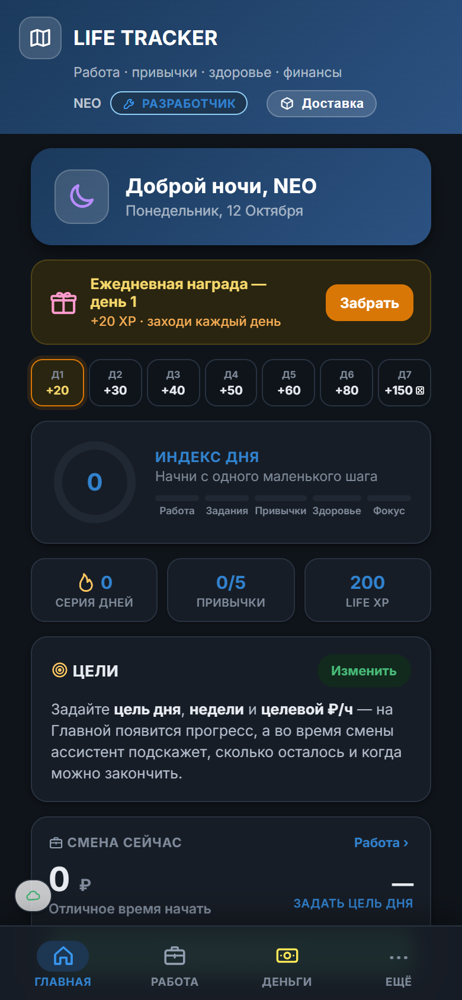
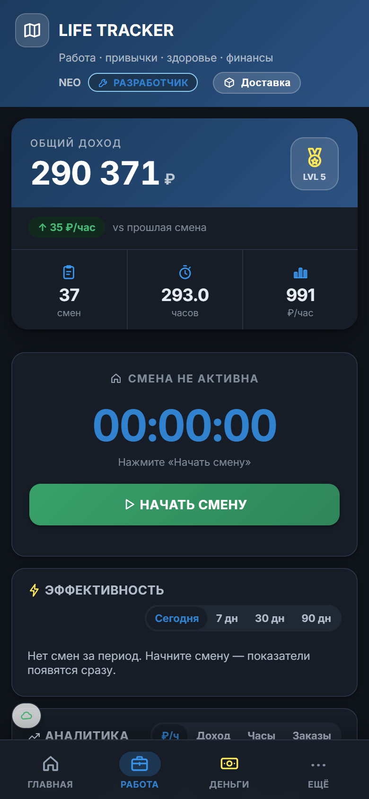
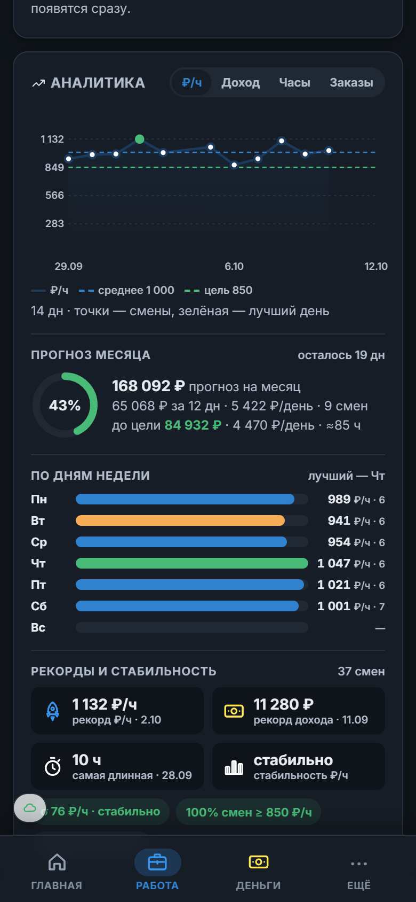
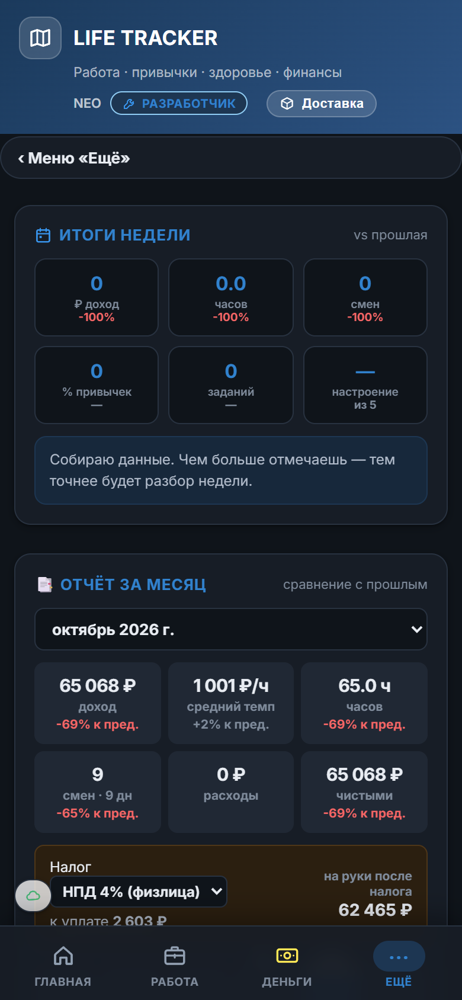
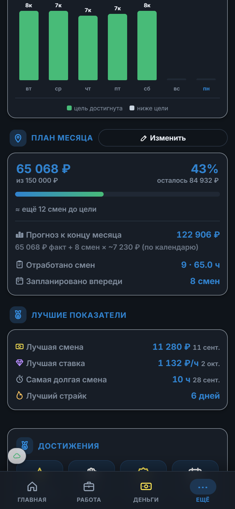

# Life Tracker

PWA-трекер для тех, кто работает сменами (доставка, склад, фриланс) и хочет видеть, **сколько реально стоит час**, — плюс привычки, задания, здоровье и финансы в одном приложении.

**Открыть:** https://sosksak.github.io/life-tracker/ — добавь на главный экран (iOS: Поделиться → На экран «Домой»).

| Главная | Работа | Аналитика | Статистика | План месяца |
|---|---|---|---|---|
|  |  |  |  |  |

## Что умеет

**Работа**
- Смена одной кнопкой: таймер, перерывы, счётчик заказов `+1 / +5`, живой ₽/час и прогноз дохода смены.
- Ассистент смены: сравнение с твоим средним по последним 30 сменам, время до целевого ₽/ч, напоминание о перерыве.
- Расходы смены (топливо, комиссии) → «чистыми» везде: в истории, в месяце, в рекордах.
- Эффективность за сегодня / 7 / 30 / 90 дней с дельтой к прошлому периоду.
- Аналитика: ₽/ч · доход · часы · заказы по дням, лучшие дни недели, эффективность по времени старта, рекорды и стабильность.
- План месяца: цель → факт / прогноз / «ещё N смен». Прогноз считается по сменам, отмеченным в календаре (📋), а если план не отмечен — по текущему темпу.
- Отчёт за месяц: KPI с дельтой, налог (НПД / УСН / НДФЛ), график 6 месяцев, экспорт PDF и CSV.

**Жизнь**
- Привычки, задания по направлениям, здоровье, фокус-сессии, рефлексия дня.
- Индекс дня — одна цифра, собранная из работы, заданий, привычек, здоровья и фокуса.
- Life XP, уровни (за смены и часы), серия дней, достижения, магазин бустов и тем.

**Деньги**
- Кошелёк, Копилка, Путь к миллиону, бюджет месяца.
- Биржа: живой курс BTC/ETH/SOL/TON (CoinGecko), USD/RUB, графики 1Д–1Г, курс на любой момент времени.

**Под капотом**
- Один HTML-файл, без фреймворков и сборщиков. Service Worker: cache-first, обновление по ETag под сплэшем — старая версия не мигает.
- Данные: Supabase (синхронизация между устройствами) с офлайн-очередью и локальным фолбэком. Профили с паролем (PBKDF2), роли, тёмная / светлая / авто тема.
- JSON-бэкап всего состояния: экспорт и импорт.

## Разработка

```
src/app.html   # всё приложение
src/sw.js      # service worker
python build.py   # → index.html + sw.js (прописывает версию)
```

Версия задаётся в `src/app.html` (`<meta name="app-version">`), `build.py` подставляет её в SW. Деплой — push в `main`, GitHub Pages.

`config.js` — URL и anon-ключ Supabase, схема таблицы прогресса — `supabase_progress.sql`.
